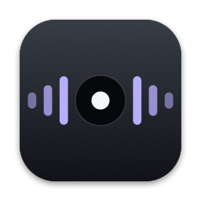

# typingRT

Native macOS-App zum Diktieren: rechte Option-Taste (`⌥`) gedrückt halten, sprechen, loslassen. Der Text erscheint am Textcursor der gerade aktiven App. Die Spracherkennung läuft lokal auf dem Mac.

- **Standard:** vollständig lokal. Whisper transkribiert in der Originalsprache, Fülllaute werden konservativ entfernt, eigenes Wörterbuch und Snippets werden angewendet. Keine Netzwerkverarbeitung.
- **Coding:** lokale Transkription, danach formuliert ein frei wählbares Sprachmodell über [Requesty](https://www.requesty.ai) aus dem (z. B. deutschen) Diktat einen englischen Entwickler-Prompt. Es wird nur Text gesendet, nie Audio.

## Stand

Entwicklungsstand 0.12.7. Alle zwölf geplanten Funktionsbereiche sind implementiert; 217 App-/Kerntests, 17 Worker-Tests (drei davon nur mit lokal installiertem Modell) und 35 Tests der Build-Werkzeuge bestehen (ein nativer Schlüsselbund-Test wird übersprungen).

Am Gerät bestätigt: lokales Diktat im Standard-Modus, Einfügen ins Terminal, Diktieranzeige mit Pegel und Moduswahl.

Noch nicht am Gerät bestätigt bzw. offen:

- Coding-Modus mit echtem Requesty-Schlüssel und Modell
- Messung von Latenz und Speicherbedarf, Login-Start, Bedienung mit VoiceOver
- Getestet nur auf einem MacBook Air M4 (16 GB) mit macOS 27 und Swift 6.4; andere Systeme ungeprüft
- Es gibt keine fertig signierte oder notarisierte Download-Version. Die App wird lokal aus dem Quellcode gebaut.

## Voraussetzungen

- Mac mit Apple-Chip, macOS 15 oder neuer
- Swift-6-Toolchain mit macOS-SDK (Xcode oder Command Line Tools)
- Internetzugang für den ersten Build (Paketauflösung von GitHub) und für den einmaligen Modell-Download
- Für den Coding-Modus: ein eigener Requesty-API-Schlüssel

## Bauen und starten

```sh
git clone <repository-url> typingRT
cd typingRT
bash scripts/swift-tool.sh test -j 4          # optional: Tests
bash scripts/enable-local-app.sh              # baut und öffnet dist/typingRT.app
```

Für die Arbeit am Code gibt es ein getrenntes Entwicklungsbundle mit eigenen Daten und Einstellungen:

```sh
bash scripts/build-app.sh debug typingRT-development development
open dist/typingRT-development.app
```

`build-app.sh` baut zuerst vollständig in ein Zwischenverzeichnis, signiert und ersetzt ein vorhandenes Bundle erst danach. Eine laufende App muss vorher über das Menüleistensymbol beendet werden.

## Einrichtung

1. **Mikrofon** erlauben, wenn die App danach fragt.
2. **Bedienungshilfen** freigeben: Systemeinstellungen → Datenschutz & Sicherheit → Bedienungshilfen → `typingRT` hinzufügen. Die App braucht das, um die rechte Option-Taste global zu erkennen und Text einzufügen.
3. **Modell installieren:** Im App-Fenster unter „Modelle & API“ das lokale Modell laden (Whisper Large v3 Turbo, rund 626 MB, von Hugging Face). Größe und Prüfsumme jeder Datei werden geprüft.
4. Optional für **Coding:** Requesty-Schlüssel eintragen und ein Textmodell wählen. Der Schlüssel wird im macOS-Schlüsselbund gespeichert.

> **Bekannte Grenze:** Der lokale Build ist ad hoc signiert. macOS bindet die Bedienungshilfen-Freigabe dann an den Codestand, sodass sie nach jedem neuen Build erneut erteilt werden muss (Eintrag entfernen und neu hinzufügen). Mit einer eigenen Code-Signing-Identität im Schlüsselbund lässt sich das vermeiden: `TYPINGRT_SIGNING_MODE=certificate bash scripts/enable-local-app.sh` (siehe `scripts/local-signing.py`; dieser Weg ist bisher nicht am Gerät bestätigt).

## Bedienung

- Rechte `⌥` halten: Aufnahme, auch mehrere Minuten und mit Sprechpausen. Linke `⌥` löst nichts aus.
- Loslassen: Transkription und genau eine Einfügung am aktuellen Textcursor. Es wird nie Enter gesendet.
- `Esc` während Aufnahme oder Verarbeitung verwirft das Diktat.
- Am unteren Bildschirmrand sitzt ein kleiner Punkt. Mit dem Mauszeiger darüber lässt sich zwischen Standard und Coding wechseln; alternativ über das Menüleistensymbol.
- Kann nicht sicher eingefügt werden (kein Textfeld, Passwortfeld), bleibt das Ergebnis zum Kopieren oder Verwerfen bereit.
- In bekannten Terminal-Apps wird einzeilig eingefügt: Zeilenumbrüche und Tabs werden zu Leerzeichen, damit kein Befehl abgeschickt werden kann. Der Text bleibt dort zusätzlich in der Zwischenablage.

## Datenschutz

- Audio verlässt den Mac nie. Aufnahmen liegen nur kurz als temporäre Datei vor und werden nach der Transkription gelöscht.
- Standard-Modus: keine Netzwerkverarbeitung des Diktats, kein stiller Cloud-Rückfall.
- Coding-Modus: gesendet werden der bereinigte Text, relevante Wörterbuch-Schreibweisen und die Liste geschützter Namen. Nicht gesendet werden Audio und Snippet-Vorlagen.
- Keine Historie von Aufnahmen oder Texten; Schlüssel, Audio und Transkripte werden nicht protokolliert.
- Es gibt keinen zentralen API-Schlüssel und keinen typingRT-Server. Jede Installation nutzt eigene Zugänge.

## Aufbau

```text
Sources/TypingRTApp/         SwiftUI/AppKit-Oberfläche und Zusammensetzen der Dienste
Sources/TypingRTCore/        Sitzungslogik, Audio, Text, Wörterbuch, Snippets, Requesty, Kennzahlen
Workers/TranscriptionWorker/ eigenes SwiftPM-Paket: WhisperKit/Core ML in einem separaten XPC-Prozess
Tests/                       Swift-Tests und Tests der Build-Werkzeuge
scripts/                     Build, Bundling, Signierung, Icon
Resources/                   Info.plist, App-Icon, Lizenzhinweise Dritter
```

Stack: Swift 6, SwiftUI und AppKit, AVAudioEngine, [WhisperKit](https://github.com/argmaxinc/WhisperKit) 1.1.1 mit Core ML, SQLite, URLSession. Kein Web-Stack, kein Server.

## Sicherheit

Zugangsdaten gehören nie ins Repository. Regeln und Meldeweg: [SECURITY.md](SECURITY.md).

## Lizenz

[MIT](LICENSE). Lizenzhinweise der eingebundenen Pakete (Argmax/WhisperKit: MIT, Swift Argument Parser: Apache 2.0) liegen unter [Resources/ThirdParty](Resources/ThirdParty) und werden mit der App ausgeliefert. Das Whisper-Modell wird nicht mitgeliefert, sondern bei der Einrichtung geladen.
